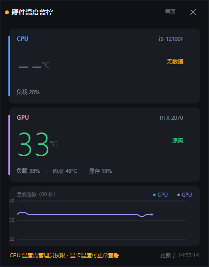

# 硬件温度监控

双击就能看到 CPU 和显卡温度的极简小窗。一个 exe、一个 dll，不联网、不装服务、没有广告。



> 管理员模式下的实际运行画面（i3-12100F + RTX 2070）。

## 为什么写它

任务管理器看不到 CPU 温度，装了监控软件又要面对一堆面板、后台服务、登录账号。
我平时只想知道一件事：现在多少度。所以做了这个只有两张卡片的窗口。

## 特点

- **大字温度**：CPU / GPU 各一张卡，50pt 数字，余光就能看清
- **颜色分级**：< 70℃ 绿、70–85℃ 黄、> 85℃ 红，底部状态栏给一句话结论
- **60 秒趋势**：下方曲线，纵轴按实际温度自适应，不用手动调范围
- **不抢地盘**：无边框卡片，按住顶部可拖动，位置自动记住；「置顶」可钉在最上层
- **随手关**：点右上角 ✕，或直接按 Esc
- **干净**：单 exe + 单 dll，离线运行，不写注册表，卸载 = 删文件夹

## 下载与使用

1. 到 [Releases](../../releases) 下载 `HardwareTemp-v1.0.0.zip`
2. 解压到任意位置（**不要放 `C:\Program Files`**，程序要往自己目录写日志和驱动文件）
3. 双击 `HardwareTemp.exe`，UAC 提示点「是」
4. 想放桌面：右键 exe → 发送到 → 桌面快捷方式

点「否」程序照样打开，只是 CPU 那一栏显示 `--`，显卡温度不受影响。

## 为什么需要管理员权限

CPU 温度不在任何普通 API 里，必须读 MSR / EC 寄存器，而 Windows 不允许普通进程碰这些寄存器，
只能经由内核驱动完成。程序用 [LibreHardwareMonitor](https://github.com/LibreHardwareMonitor/LibreHardwareMonitor)
自带的 WinRing0 驱动来读，加载驱动需要管理员权限。显卡温度走 NVAPI，不需要提权。

程序只做两件事：读传感器、画界面。没有网络代码，不开机自启，没有后台服务。

## 系统要求

| | |
|---|---|
| 系统 | Windows 10 1903 及以上 / Windows 11，**64 位** |
| 运行时 | .NET Framework 4.8（Win10/11 系统自带） |
| 权限 | 管理员（读 CPU 温度）；普通权限可看显卡温度 |

## 杀毒软件与驱动拦截

**这是这类工具目前最常见的问题，先看这段再判断。**

2025 年 3 月起，Microsoft Defender 开始把 WinRing0 驱动判定为 HackTool（源于历史漏洞
CVE-2020-14979），HWiNFO、Fan Control、雷蛇 Synapse 等一批硬件工具都被牵连。常见表现：

- 下载后 Defender 直接删掉 exe 或 `HardwareTemp.sys`
- 程序能打开，但 CPU 一直显示 `--`
- 开启「内存完整性（HVCI）」的机器上驱动可能加载失败

处理办法，按推荐顺序：

1. 给程序所在文件夹加 Defender 排除项
2. 关闭「内存完整性」后重启（Windows 安全中心 → 设备安全性 → 内核隔离）
3. 都不行就只当显卡温度计用

**不建议**为一个小工具长期关掉系统安全功能，值不值自行权衡。

## 已知限制

- 只支持 64 位 Windows，没有 32 位和 ARM 版本
- CPU 取 `CPU Package`，没有该传感器时退回 `Core Max` / `Core Average`；
  部分 AMD 平台或笔记本读不到，会显示 `--`
- 只读温度、负载、频率；不改风扇曲线，不超频
- 每秒采样一次，够看趋势，不适合当压测记录工具
- 未做数字签名，首次运行会有 SmartScreen 提示：更多信息 → 仍要运行

## 从源码构建

不需要 Visual Studio，用 Windows 自带的 .NET Framework 4.8 编译器即可。

```powershell
powershell -ExecutionPolicy Bypass -File .\build.ps1
# 指定版本号
powershell -ExecutionPolicy Bypass -File .\build.ps1 -Version 1.0.1
```

产物：

- `HardwareTemp.exe` —— 主程序
- `release\HardwareTemp-v1.0.0.zip` —— 分发包
- `release\SHA256.txt` —— 校验值

等价的单条命令：

```powershell
& "$env:SystemRoot\Microsoft.NET\Framework64\v4.0.30319\csc.exe" `
  /target:winexe /codepage:65001 /optimize+ /platform:x64 `
  /out:HardwareTemp.exe /win32manifest:app.manifest /win32icon:app.ico `
  /reference:System.dll /reference:System.Core.dll `
  /reference:System.Drawing.dll /reference:System.Windows.Forms.dll `
  /reference:LibreHardwareMonitorLib.dll Program.cs
```

## 目录结构

| 路径 | 说明 |
|---|---|
| `Program.cs` | 全部源码：界面自绘 + 传感器读取 + 交互，单文件 |
| `LibreHardwareMonitorLib.dll` | 传感器库，必须与 exe 同目录，否则程序集绑定失败 |
| `app.manifest` | 高 DPI 声明、窗口阴影、提权策略 |
| `app.ico` | 图标 |
| `build.ps1` | 一键编译 + 打包 + 算校验值 |
| `packaging/使用说明.txt` | 随包附带的用户说明 |
| `tools/gen_icon.py` | 用 Pillow 画图标（仅开发时使用） |
| `docs/screenshot.png` | 截图 |
| `LICENSE`、`THIRD-PARTY-NOTICES.md`、`LICENSES/` | 许可相关 |

## 实现上的几个选择

- **全自绘界面**：`FormBorderStyle.None` + GDI+ 手绘，圆角卡片、曲线、悬停态都是画出来的，没有用控件拼装
- **提权兜底**：manifest 用 `asInvoker`，启动时自己 `ShellExecute("runas")` 重新拉起；
  用户拒绝 UAC 则降级为普通模式继续运行，保证「双击一定有反应」
- **按钮命中区独立**：标题栏拖动区和按钮点击区分开判定，避免拖动逻辑吞掉按钮点击
- **单实例**：命名互斥量 `Local\HardwareTempMonitorSingle`，不会开出一堆窗口
- **传感器只 Open 一次**：`Computer` 对象启动时 `Open()`，之后每秒 `Update()`，避免驱动反复加载

## 许可

本项目代码：[MIT](LICENSE)

第三方组件：

- [LibreHardwareMonitor](https://github.com/LibreHardwareMonitor/LibreHardwareMonitor) 的
  `LibreHardwareMonitorLib`，MPL-2.0，**未修改原样分发**，许可全文见 `LICENSES/MPL-2.0.txt`
- WinRing0 驱动随该库内嵌分发，BSD 3-Clause

详见 [THIRD-PARTY-NOTICES.md](THIRD-PARTY-NOTICES.md)。

## 致谢

传感器读取全部来自 LibreHardwareMonitor 项目，没有它这个程序写不出来。
